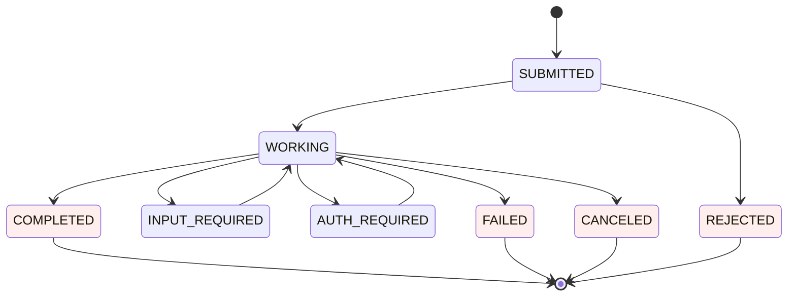
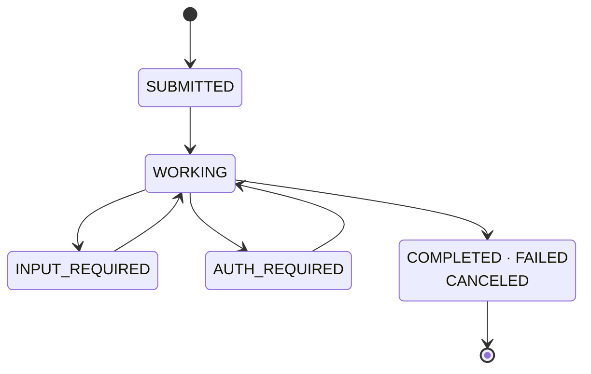

# The gates, applied

One draft, the defects the gates find in it, and the fence that survives. The syntax is agentic-system.design's; the reasoning is the point.

## The lesson

A Bite on the lifecycle of a long-running task between a client and a server. Its prose says: a task is created `SUBMITTED`; the server moves it to `WORKING`; while working it may pause in `INPUT_REQUIRED` or `AUTH_REQUIRED` and resume to `WORKING` when the client responds; it ends in one of `COMPLETED`, `FAILED` or `CANCELED`. A table in the same section lists the four terminal states with one line each on what the client may do next.

## Draft

## What the gates find

| Gate | Defect                                                                                                                                     |
| ---- | ------------------------------------------------------------------------------------------------------------------------------------------ |
| 3    | `SUBMITTED --> REJECTED` and the `REJECTED` state are not in the prose. They are true of the protocol and still out of bounds: the lesson does not teach them. |
| 4    | Four terminal states drawn one by one restate the table beside the diagram.                                                                 |
| 5    | Thirteen transitions for one lifecycle, four of them the same "ends" edge.                                                                  |
| 6    | No accessible title or description.                                                                                                         |
| 7    | `classDef … fill:#fee` — colour is the site's, and the build refuses it.                                                                    |
| 8    | No lead sentence states the claim.                                                                                                          |

## Accepted

The sentence before the fence: "A task pauses and resumes any number of times before it ends."

- **Reader's question:** what states can a task be in, and what moves it between them?
- **Traceable:** every state and transition is a sentence of the prose; the invented `REJECTED` path is gone.
- **Not the table:** the terminal states are one node, so the table beside it keeps its job — what the client may do next — and the diagram keeps its own: the pause-and-resume loop.
- **Shape:** two loops back to `WORKING` and one exit are visible with the labels covered.
- **Form:** eight transitions, none labelled because each target state already names what happened, top-down, the long terminal label broken with ` `, no styling, the title and the lead sentence making the same claim.

Use it only where a lesson teaches this lifecycle in these words; it illustrates the gates, it is not a diagram to reuse.
